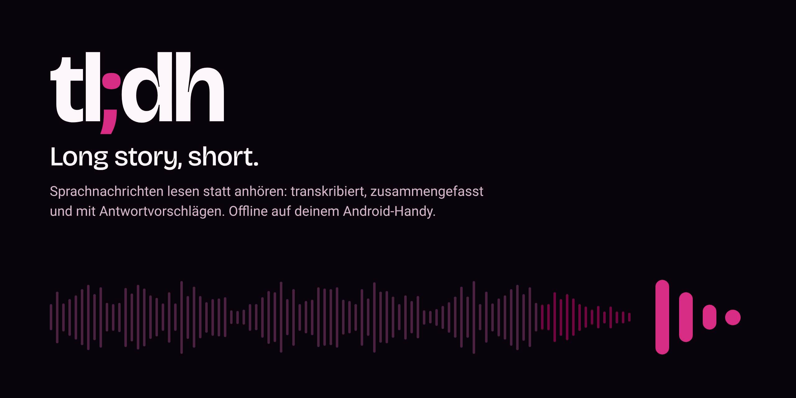

<p align="center">
  
</p>

<p align="center">
  <a href="https://github.com/Labushuya/tldh/actions/workflows/ci.yml"></a>
  <a href="https://github.com/Labushuya/tldh/releases/latest"></a>
  
  
  
</p>

# tl;dh

**too long; didn't hear.** Share a WhatsApp voice note to tl;dh and read what it says in seconds: a verbatim summary, the questions and dates in it, ready-made replies. Everything runs on your phone. Nothing is uploaded.

> **Status:** `v0.7.3` · redesigned app that keeps working in the background. Rotate the phone, switch apps or turn the display off: the voice note keeps processing and tl;dh tells you when it's done.

## How it works

1. In WhatsApp, long-press a voice note → **Share** → **tl;dh**, or tap **Audiodatei öffnen** in the app.
2. tl;dh transcribes it on the device with [whisper.cpp](https://github.com/ggml-org/whisper.cpp). You can watch the waveform fill and the first sentences appear, or put the phone away: processing continues in the background and a notification tells you when it's ready.
3. You get the result:
   - **Kurz gesagt** – the most informative sentences, word for word from the transcript.
   - **Stellen prüfen** – uncertain words that can change the meaning (negations, times, numbers, conditions, must/can), each with a play button for that exact moment.
   - **Kernpunkte** – questions to you, dates and amounts, requests.
   - **Antworten** – three replies in your tone (kurz, freundlich, förmlich), one tap to copy. Or copy the whole thing as a note.
   - **Transkript** – uncertain words are tinted *and* underlined (dotted = unsure, wavy = very unsure), tap to hear them.
4. Close the result and the session is gone: audio, transcript and summary are deleted.

Nothing is generated or invented: summaries and replies are built by rules from what was actually said.

## Privacy

- Speech recognition and summary run **only on the phone**. No cloud, no account, no analytics, no ads.
- Internet is used for exactly two things, both only when you tap: downloading a recognition model once (60 or 190 MB, pinned revision, SHA-256 verified) and checking for app updates.
- Audio and transcript live in a per-session folder that is wiped when you close the result, when you share the next voice note, and on the next app start (in case Android killed the app).
- Copied text is marked as sensitive, so Android 13+ hides it from the clipboard preview.
- Notifications (progress, "Zusammenfassung fertig") never contain anything from the voice note.

Details: [docs/privacy.md](docs/privacy.md).

## Install

Download `tldh-<version>.apk` from the [latest release](https://github.com/Labushuya/tldh/releases/latest) and open it. Later updates come from inside the app (**Einstellungen → Updates → Prüfen**); every APK is checked against its SHA-256 before Android's installer opens. No background polling, no silent installs.

Requirements: Android 9 or newer on a 64-bit ARM phone (arm64-v8a). The app recommends a model for your phone:

| Model | Size | For |
|---|---:|---|
| Ausgewogen · Whisper base (q5_1) | 60 MB | every arm64 phone, fast |
| Genau · Whisper small (q5_1) | 190 MB | phones with dotprod/fp16 CPU and ≥ 6 GB RAM, clearly fewer mishearings |

Supported audio: WhatsApp and Telegram voice notes (Ogg/Opus) and files picked from storage (M4A/AAC, MP3, WAV, FLAC, AMR, WebM), up to 50 MB and 15 minutes.

## Design

The app follows one dark, calm visual system: depth from surface steps instead of glow, the magenta accent only for the main action and state, Bricolage Grotesque for headlines, frosted glass only on chrome that floats over content. The full spec lives in [DESIGN.md](DESIGN.md); logo and banner sources are in [docs/brand](docs/brand/README.md).

## Build

```bash
bash scripts/gradle.sh lintDebug testDebugUnitTest assembleDebug
```

`scripts/gradle.sh` uses an installed Gradle or bootstraps one. The build cross-compiles `whisper-cli` (whisper.cpp `v1.9.5`, pinned commit) for arm64-v8a with NDK `27.2.12479018` in two CPU variants; see [scripts/build-whisper-android.sh](scripts/build-whisper-android.sh).

Signed releases are built by CI on every version bump merged to `main` and need `ANDROID_KEYSTORE_FILE`, `ANDROID_KEYSTORE_PASSWORD`, `ANDROID_KEY_ALIAS` and `ANDROID_KEY_PASSWORD`.

Baseline: Kotlin 2.4 · AGP 9.2.1 · Compose BOM 2026.04.01 · compileSdk/targetSdk 36 · minSdk 28 · package `dev.bitsbots.tldh`.

More: [architecture](docs/architecture.md) · [release process](docs/release.md) · [updater rules](docs/updater.md) · [testing](docs/testing.md) · [changelog](CHANGELOG.md).

## Roadmap

| Version | Goal |
|---:|---|
| `0.4.0` | whisper.cpp transcription, word confidence, snippet playback |
| `0.5.0` | Meaning checks, rule-based TL;DR and key points |
| `0.6.0` | Reply suggestions in three tones, note mode |
| `0.7.0` | Redesign: new screens, glass details, file picker, live text, new icon |
| **`0.7.1`** | **Background processing that survives rotation and display off** |
| `0.8.x` | Optional on-device AI pack for capable phones, after an LLM benchmark in the STT bench (never required) |
| later | Tags and categories |
| `0.9.0` | Testing, benchmarking, release candidate |
| `1.0.0` | Public stable release |

The separate [STT bench](stt-bench/README.md) app compares speech-to-text engines on real voice notes.

## License

MIT, see [LICENSE](LICENSE). Third-party components (whisper.cpp, Whisper models, Bricolage Grotesque) are listed in [THIRD_PARTY_NOTICES.md](THIRD_PARTY_NOTICES.md).
